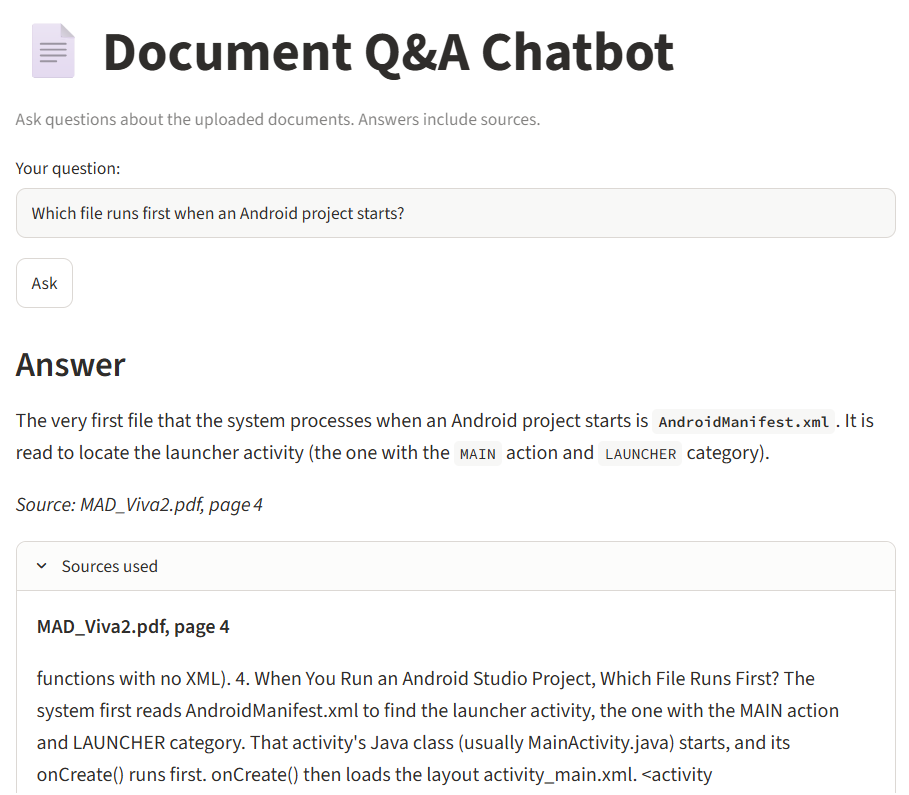
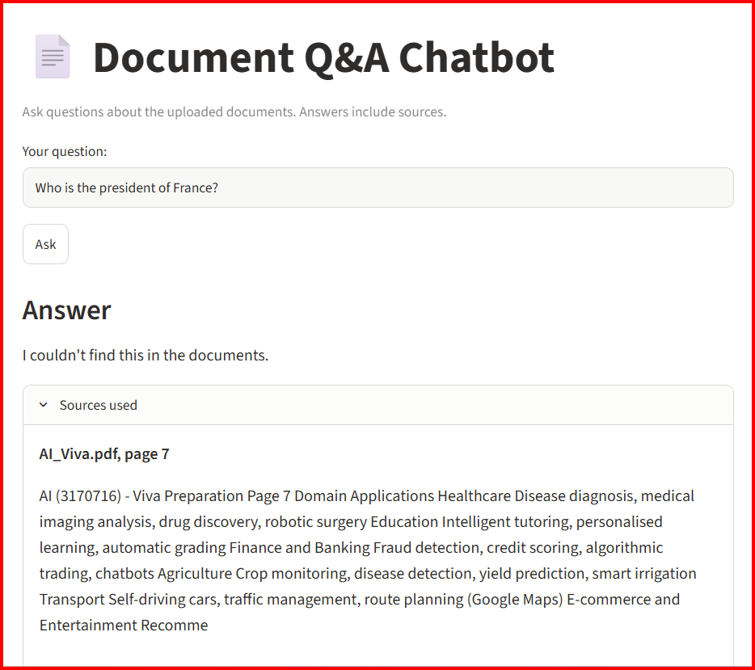

# Document Q&A Chatbot (RAG)

A chatbot that answers questions about AI and Mobile App Development viva notes
and cites the source file and page for every answer. If the answer is not in the
documents, it says so instead of guessing.

**Live demo:** https://genai-doc-chatbot-ni6h2igv8dx9zt8u4xbhqd.streamlit.app/




## Problem

Notes are spread across several long PDFs, so finding one fact means searching
each file by hand. This app answers a plain-English question and shows the
exact file and page it came from.

## How it works

```
PDFs -> chunks (300 chars, 50 overlap) -> embeddings -> ChromaDB
     -> top 4 chunks -> LLM (gpt-oss-20b via Groq) -> answer + citations
```

- `src/ingest.py` reads PDFs page by page, chunks the text, and stores it in
  ChromaDB with the file name and page number.
- `src/answer.py` retrieves the 4 most relevant chunks and asks the LLM to answer
  only from them, cite the source, and refuse if the answer is missing.
- `src/app.py` is the Streamlit interface.

## Tech stack

Python, pypdf, ChromaDB, Groq API (`openai/gpt-oss-20b`), Streamlit, pandas

## Run locally

1. `git clone https://github.com/yug19tech/genai-doc-chatbot.git`
2. `cd genai-doc-chatbot`
3. `python -m venv venv` then `venv\Scripts\activate`
4. `pip install -r requirements.txt`
5. Copy `.env.example` to `.env` and add your free Groq API key
6. Put PDFs in `data/`, then run `python src/ingest.py`
7. `streamlit run src/app.py`

## Evaluation

**Tuning set (24 questions, 4 out-of-scope):**

| Chunk size | Overlap | Top-k | Accuracy |
|---|---|---|---|
| 500 | 50 | 4 | 95.8% (91.7% before fixing the checker) |
| 500 | 50 | 6 | 95.8% |
| 300 | 50 | 4 | 100% |
| 800 | 100 | 4 | 100% |

The single failure at chunk size 500 was a question about a table
(fragment lifecycle) whose chunk was split badly. Increasing top-k did not
fix it; changing chunk size did. Chunk 300 / overlap 50 was chosen as the final
setting as a tiebreak, since several settings scored 100%.
The first strict keyword check also wrongly failed one correct answer
because of a special hyphen character; I fixed the checker by normalising text.

**Held-out set (12 new questions, 2 out-of-scope), run once with no tuning:**
83.3% (10/12). All out-of-scope questions were correctly refused.

Failures:
- "What does BAM stand for?": retrieval miss. The relevant chunk (AI_Viva p5)
  was not in the top 4, so the bot correctly refused instead of guessing.
- "Which Android library is type-safe and annotation-based?": retrieval miss.
  The relevant chunk (MAD_Viva2 p7) was not retrieved; again the bot refused
  rather than hallucinate.

Both held-out failures were retrieval problems, not generation problems. This
matches the table failure in the tuning set, so improving retrieval is the next
priority.

The 100% tuning score is optimistic because I tuned on those questions; the
held-out score is the more honest number.

## Limitations and next steps

- Small test sets written by me from the same documents, so scores may be optimistic.
- Keyword matching can miss correct answers that are phrased differently
  (next step: LLM-based judge).
- Retrieval can miss content in short list items and tables (next steps:
  hybrid keyword + vector search, re-ranking, a stronger embedding model),
  to be tested on a fresh question set.
- Scanned PDFs are not supported (would need OCR). No chat history.